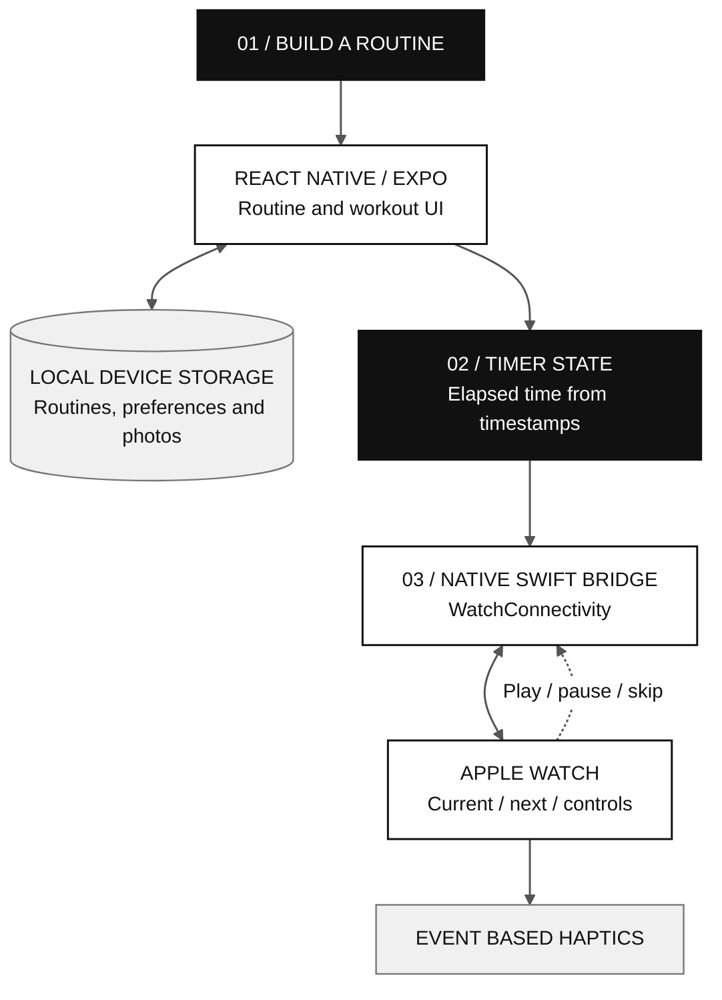

# CONCRETE SETS

**An offline-first workout timer for iPhone and Apple Watch. Designed and built by Barbara K. Prokop.**

I wanted a training timer that behaved like a tool: set up a routine, start it, and concentrate on the workout instead of navigating a fitness platform.

Concrete Sets is a mobile product built with React Native, Expo and native watchOS integration. It stores routines locally, supports ordered exercises and breaks, and sends workout state and controls between the iPhone and Apple Watch.

**This is a public technical companion, not the complete application.** My original `concrete-set` source repository remains private. The small JavaScript examples below are standalone adaptations of real app decisions, with invented workout data and no native dependencies or secrets.

[View the portfolio case study](https://barbarakprokop.com/productdesign/case-study-concrete-sets/) · [Product design portfolio](https://barbarakprokop.com/productdesign/) · [My GitHub profile](https://github.com/barbarakprokop)

## The design problem

Workout timers often demand accounts, tracking, routines tied to services, and attention that should be spent training. I treated this as a focused **training tool**, not a broader fitness platform.

- **Start quickly.** Build and reorder routines, including timed breaks.
- **Work offline.** The iPhone stores routines and exercise photos locally, without a backend.
- **Keep time accurately.** When the app resumes, derive elapsed workout time from a timestamp rather than assuming interval callbacks kept firing.
- **Use the watch as a companion.** Show the current exercise, remaining time, the next item, and controls with tactile feedback.

## Architecture



This schematic summarizes the inspected private repository. Actual WatchConnectivity uses a native Expo module in Swift and a watchOS companion. It is **not** an independent watch app that runs full workout logic without the iPhone.

## Real implementation decisions

| Decision | What it solves |
| --- | --- |
| Timestamp-based rollover | The correct next exercise can be recovered after suspended callbacks or app resume. |
| Explicit workout item data | Timed exercises and breaks can be represented and reordered using the same simple model. |
| One latest watch state snapshot | `WCSession.updateApplicationContext` retains the latest snapshot after temporary disconnection. |
| Commands separated from state | Watch controls send explicit play, pause, previous and next actions back to the phone. |
| Haptics from state transitions | Watch cues respond to workout changes instead of SwiftUI redraws. |
| Local-only routine storage | No account, backend, telemetry or subscription is needed for the core product. |

**Selected code:**

- [`src/workout-timeline.mjs`](src/workout-timeline.mjs): adapted timer rollover logic.
- [`src/watch-state.mjs`](src/watch-state.mjs): an isolated watch state contract and action validation.
- [`src/routine-utils.mjs`](src/routine-utils.mjs): ordered routine logic and display formatting.
- [`tests/logic.test.mjs`](tests/logic.test.mjs): standalone tests for the public examples.
- [`examples/routine.json`](examples/routine.json): a fictional workout.
- [Technical decisions](docs/technical-decisions.md): native integration, tradeoffs, status and limitations.

To run the standalone examples, install Node.js 20 or newer and run:

```bash
npm test
```

The public package **does not include a working iOS or watchOS project**. The watch connectivity diagram is documentation of the private implementation, not a runnable native example.

## Scope and status

The private GitHub snapshot contains watchOS SwiftUI views and connectivity code. It also contains legacy README wording about a **future** Live Activity. I have not verified a completed ActivityKit Widget Extension in that repository; this companion therefore does **not claim that Live Activities are implemented**. App Store submission and approval are separate matters.

The examples have been tested independently against synthetic inputs, but the full application and native hardware interactions were not executed as part of preparing this public companion.

**PRODUCT DESIGNER & BUILDER · AI PRODUCTS & WORKFLOWS**

[Portfolio](https://barbarakprokop.com/productdesign/) · [LinkedIn](https://www.linkedin.com/in/barbarakprokop/) · [Security and publication boundaries](SECURITY.md)
